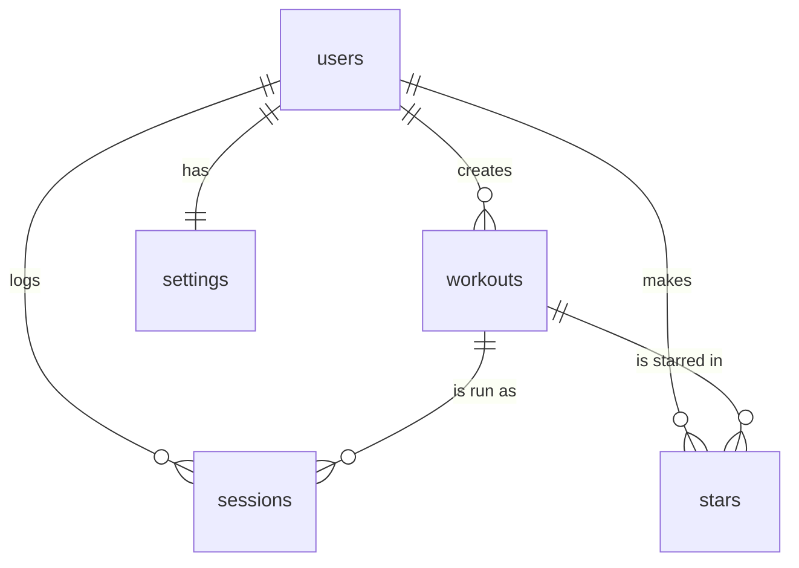

# PLAN: Treadmill Interval Coach

## 1. Pitch

I'm building **Treadmill Interval Coach** because I run interval workouts on my school gym treadmill with only my phone, and I'm tired of looking at the treadmill screen to know when to change speed. The app saves my interval workouts (for example 5 × 600 m at 10.2 km/h with a 90 s walk), plays a workout back with timed cues ("Rep 3 of 5 in 20 seconds. Set speed to 10.2", "200 meters to go"), and logs how each session went so I can see how my training changes.

I'll use it about **once a week**, on my interval day, through my November half marathon training. Anyone who runs treadmill intervals and wants to hear the next change instead of watching the screen can use it.

**Prototype disclosure:** before this assignment I built a one-page prototype (no accounts, no database) and used it in a real interval session. This project rebuilds it as a full app with accounts, a database and tests. The prototype's cue logic is the starting point for the run player (feature 9).

**Real data:** 14 of my own treadmill rep sessions from May to October 2026 (12 logged as intervals and 2 as 400 m sharpeners), imported from my run log. Free-text notes about health are removed before import.

## 2. Features

Numbered in build order. Features 1–6 and 8 are the required spine; 7, 9 and 10 are my 3 own features.

1. **Sign up and log in.** As a runner, I want to sign up and log in with my Google account and log out, so that my workouts are private and follow me from my phone to my laptop. Each account is a row in `users`, and each user sees only their own data.
2. **Create workouts (data model).** As a runner, I want to create a workout with warm-up, number of reps, rep distance, rep speed, walk time and cool-down, so that I can save a session like 5 × 600 m at 10.2 km/h.
3. **View, edit and delete workouts.** As a runner, I want a list of my workouts, a detail page for each, and the ability to edit it or delete it after an "Are you sure?" confirmation, so that I can keep my workouts accurate.
4. **Validation.** As a runner, I want a friendly message if I leave a required field blank or enter a rep distance or speed that doesn't make sense, so that I never save a broken workout.
5. **Stars.** As a runner, I want to star my favorite workouts and see a "Starred" view, so that my go-to sessions are one tap away.
6. **Find things.** As a runner, I want to search workouts by name and filter and sort them (newest, longest rep, fastest speed), so that I can find a session quickly.
7. **(Own) Log a session and post-run survey.** As a runner, I want to log a finished session with its date, reps completed, a 1–5 effort rating and what was hard (breathing, legs, mental, stitch or stomach, pace too fast, nothing), so that I can look back at how each workout felt.
8. **Dashboard.** As a runner, I want to see my session count, total hard-rep distance, average rep speed, and a bar chart of hard-rep distance for each session over time, so that I can tell whether I'm building up more hard running.
9. **(Own) Run player.** As a runner, I want to start a saved workout and hear and see timed cues (speed to set, 20-second heads-up, 200 m and 100 m to go, walk and rep changes, praise), so that I never have to look at the treadmill.
10. **(Own) Countdown preferences.** As a runner, I want to choose a countdown before each change (10, 5 or no seconds before walking; 15, 10, 5 or no seconds before the next rep), so that the cues match how I like to run.

## 3. Database

Relationships: users to workouts is one-to-many; users to sessions is one-to-many; workouts to sessions is one-to-many; users to workouts through `stars` is many-to-many; users to settings is one-to-one.

**users** (one row per account; created automatically on first Google sign-in)

| Column | Type | Notes |
|---|---|---|
| id | uuid | primary key, same as the Supabase auth id |
| email | text | |
| display_name | text | |
| created_at | date and time | |

**workouts** (the main item)

| Column | Type | Notes |
|---|---|---|
| id | uuid | primary key |
| user_id | uuid | foreign key to users.id |
| name | text | required |
| warmup_min | number | |
| warmup_speed_kmh | number | |
| reps | number | required, whole number |
| rep_distance_m | number | required, meters |
| rep_speed_kmh | number | required |
| walk_sec | number | required, seconds |
| walk_speed_kmh | number | |
| cooldown_min | number | |
| cooldown_speed_kmh | number | |
| notes | text | |
| created_at | date and time | |

**sessions** (one row per completed run)

| Column | Type | Notes |
|---|---|---|
| id | uuid | primary key |
| user_id | uuid | foreign key to users.id |
| workout_id | uuid | foreign key to workouts.id |
| run_date | date | required |
| reps_completed | number | required |
| effort | number | 1–5, left empty for imported history I haven't rated |
| hardest_part | text | one of: breathing, legs, mental, stitch or stomach, pace too fast, nothing |
| notes | text | |
| created_at | date and time | |

**stars** (junction table)

| Column | Type | Notes |
|---|---|---|
| user_id | uuid | foreign key to users.id |
| workout_id | uuid | foreign key to workouts.id |

Primary key is the pair (user_id, workout_id), so a user can star a workout only once.

**settings** (one row per user)

| Column | Type | Notes |
|---|---|---|
| user_id | uuid | primary key and foreign key to users.id |
| voice | text | name of the browser voice |
| lead_sec | number | heads-up before each change, default 20 |
| countdown_to_walk_sec | number | 10, 5 or 0 (off) |
| countdown_to_rep_sec | number | 15, 10, 5 or 0 (off) |
| encouragement | text | off, light or frequent |

## 4. Tests

1. **Data isolation.** *Given* User A has saved a workout called "5 × 600 m" and User B has just signed up with no workouts, *when* User B requests the workout list and also tries to open User A's workout by its id, *then* User B gets an empty list and a "not found" for A's workout.
2. **Dashboard.** *Given* a user has three logged sessions with completed reps of 5 × 600 m, 4 × 400 m and 5 × 800 m, *when* the dashboard calculates total hard-rep distance, *then* it shows 8,600 m (3,000 + 1,600 + 4,000).

## 5. Technologies

- **Coding agent: Claude Code.** I'm using it because I know Claude's style from earlier work on this project, and the course allows any agent.
- **Database: Supabase (Postgres).** It gives me a hosted relational database with row-level security, which enforces "each user sees only their own data."
- **Sign up and login: Google sign-in through Supabase Auth.** It means no passwords to store, and it's what I chose over email and password.
- **Web framework: Next.js (React).** It handles pages, the data connection and deployment in one project, and it's what the agent knows best.
- **Hosting: Vercel.** It deploys from GitHub on every merge, so the live URL stays current.
- **Charts: Recharts.** It's a small React chart library for the dashboard bar chart.
- **Cues: browser Web Speech API and Web Audio.** They need no paid service, and my prototype already uses them.
- **Tests: Vitest.** It's a simple test runner that works with Next.js.

## 6. Design

Fun and playful, with a **red, yellow, black and white** palette: paper background `#FFFEF8`, ink `#141414`, red `#D8222A`, yellow `#FFD60A`. Rounded cards with thick black outlines and a hard drop shadow, big chunky headings (Lilita One) and friendly body text (Baloo 2). The run screen is large and readable at arm's length. I'm borrowing from **Nike Run Club** (bold run screen and spoken coaching) and **Duolingo** (playful, celebratory feedback).

## 7. Risks and cuts

- **Least sure I can build: music dimming on iPhone.** In my prototype, spoken cues sometimes stop Spotify instead of lowering it, and a web page can't override that on iOS. I won't promise dimming. The run player ships with on-screen and spoken cues, and the audio behavior is documented as a known limitation.
- **Second risk: Google sign-in setup.** It needs Google Cloud credentials and must be set to "In production," or only listed test users can sign in. For the live demo I need a spare Google account that has never used the app. Fallback: Supabase email and password.
- **What I cut first:** (1) countdown preferences (feature 10), (2) the "what was hard" survey (keep a basic log with date, reps and effort), (3) run player polish.
- **Backlog:** a "am I getting faster" trendline (rep speed over time) and pace-versus-rep-length analysis (can I hold a speed for longer reps), recorded human voice clips, music matched to the workout, outdoor navigation cues.

## 8. Plan vs. Reality

Added after building. Sections 1 to 7 above are unchanged, so you can compare what I planned with what happened. "PR" numbers point to the pull request where you can check it.

| Planned feature | Shipped / Changed / Cut | Status (Done/Backlogged) | Learning | What changed and why (one line) |
|---|---|---|---|---|
| 1. Sign up and log in | Changed | Done | Google sign-in in testing mode only lets listed test users in, so demo and test accounts must be added in advance. | The plan said "In production"; I left it in testing mode because publishing needs a homepage and privacy policy (PR #4). |
| 2. Create workouts (data model) | Shipped | Done | "Number" in my plan was not precise enough for a database. | Whole numbers are `integer` and speeds and minutes are `numeric`, with rules such as "above 0" (PR #6, `schema.md`). |
| 3. View, edit and delete workouts | Shipped | Done | Deleting a workout also deletes things that depend on it, and the runner should be told. | The delete page warns that its sessions and stars go too (PR #8). |
| 4. Validation | Shipped | Done | Friendly means one specific message per rule, and never wiping what the runner typed. | Each field has its own plain-English message and keeps its value after a mistake (PR #10). |
| 5. Stars | Shipped | Done | A junction table needs a rule that stops a runner starring someone else's workout. | Added insert checks on `stars` and `sessions` so a workout must be the runner's own (PR #12, `tests/data-isolation.test.ts`). |
| 6. Find things | Changed | Done | Checking a sort value against a list can match built-in names; check against my own keys only. | Built search, sort (plus "oldest") and a Starred tab; no separate filter, because the tab covers my real need (PR #14). |
| 7. (Own) Log a session and survey | Shipped | Done | Imported history had no effort or "hardest part", so those fields had to allow empty. | The log form requires them, but the database allows empty for old sessions (PR #16). |
| 8. Dashboard | Shipped | Backlogged (one chart label) | Raw "40,600 m" looked clunky once real data was in; a missing x-axis label on a phone is still open. | Added a kilometer format after seeing the real dashboard (PR #18, PR #23). |
| 9. (Own) Run player | Changed | Done | An agent's fix I had not tested was a guess; the real cause was the iPhone silent switch. | I added an audio-mode switch (PR #26), then Test voice and Test beep buttons and a silent-switch hint (PR #27). |
| 10. (Own) Countdown preferences | Shipped | Done | I planned to cut this first but did not have to. | Built the `settings` table and Settings page, and left out the plan's `voice` column because a web page cannot pick the phone's voice reliably (PR #29). |
| Real data: 14 sessions | Changed | Done | I should count my own data before writing a number in a plan. | The real count is 12 (9 intervals, 1 light intervals, 2 sharpeners); the dashboard shows 12 sessions and 40.6 km. |
| Risk: music dimming on iPhone | Changed | Backlogged | My desk test showed no pause and no dimming, but a real run that evening paused my music on every cue, so one test was not enough. | Dimming needs a native app; the unstable result is documented in the README and BACKLOG.md. |
| The two tests | Shipped | Done | Running the real database rules in a small in-memory Postgres (PGlite) tests security, not just my own code. | Both pass on every push; I broke one on purpose to see it fail (red) then fixed it (green); later features raised the total to 25 tests (PR #20). |
| Units toggle (km/h and mph), smaller workout list, top navigation, onboarding | Cut | Backlogged | After using the app I wanted these, but they would have put the required work at risk. | Written down in `BACKLOG.md` instead of built. |
| Run player in a real workout | Changed | Backlogged | Passing tests and a working desk test did not mean it worked on a run: the screen locked, cues were missed at the changes and the music paused. I stopped using it and timed the run myself. | Written down in `BACKLOG.md`; the screen lock and missed cues are first to fix after the assignment. |
