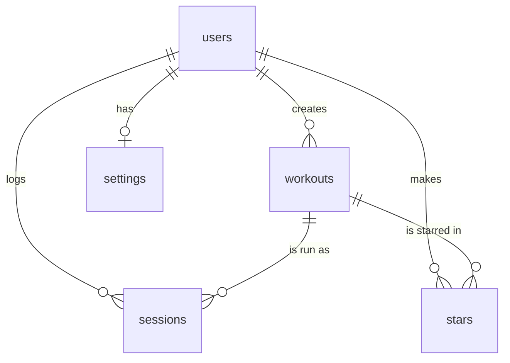

# Database schema

The database is Supabase (Postgres). The SQL that created it is in `supabase/migrations/` (run in order,
`0001` to `0005`). This file describes what exists **today** and compares it with section 3 of `PLAN.md`.

## Diagram

Relationships:
- **users to workouts:** one-to-many (a runner has many workouts; each workout belongs to one runner).
- **workouts to sessions:** one-to-many (a workout can be run many times; each session is one run of one workout).
- **users to sessions:** one-to-many.
- **users to settings:** one-to-one (a runner has at most one settings row; no row means the defaults).
- **users to workouts through stars:** many-to-many (a runner can star many workouts; the `stars` table links them).

## Tables

### users (migration 0001)
One row per account, created automatically by a database trigger on the first Google sign-in.

| Column | Type | Notes |
|---|---|---|
| id | uuid | primary key; the same id as Supabase's login record (`auth.users`) |
| email | text | |
| display_name | text | from the Google profile name, or the start of the email |
| created_at | timestamptz | default now() |

### workouts (migration 0002), the main item
| Column | Type | Notes |
|---|---|---|
| id | uuid | primary key, generated |
| user_id | uuid | foreign key to users.id, deleted along with the user |
| name | text | required, cannot be blank |
| warmup_min | numeric | optional, 0 or more |
| warmup_speed_kmh | numeric | optional, above 0 |
| reps | integer | required, above 0 |
| rep_distance_m | integer | required, above 0 |
| rep_speed_kmh | numeric | required, above 0 |
| walk_sec | integer | required, 0 or more |
| walk_speed_kmh | numeric | optional, above 0 |
| cooldown_min | numeric | optional, 0 or more |
| cooldown_speed_kmh | numeric | optional, above 0 |
| notes | text | optional |
| created_at | timestamptz | default now() |

### sessions (migration 0004)
One row per completed run of a workout.

| Column | Type | Notes |
|---|---|---|
| id | uuid | primary key, generated |
| user_id | uuid | foreign key to users.id, deleted along with the user |
| workout_id | uuid | foreign key to workouts.id, deleted along with the workout |
| run_date | date | required |
| reps_completed | integer | required, above 0 |
| effort | integer | 1 to 5, may be empty (for history that was never rated) |
| hardest_part | text | one of: breathing, legs, mental, stitch or stomach, pace too fast, nothing; may be empty |
| notes | text | optional |
| created_at | timestamptz | default now() |

### stars (migration 0003), the junction table
| Column | Type | Notes |
|---|---|---|
| user_id | uuid | foreign key to users.id |
| workout_id | uuid | foreign key to workouts.id, deleted along with the workout |

The primary key is the pair (user_id, workout_id), so a runner can star a workout only once.

### settings (migration 0005)
One row per runner, holding how the run player counts down. No row means the defaults.

| Column | Type | Notes |
|---|---|---|
| user_id | uuid | primary key and foreign key to users.id, so there is at most one row per runner |
| lead_sec | integer | heads-up before each change: 10, 20 (default) or 30 |
| countdown_to_walk_sec | integer | spoken "5, 4, 3, 2, 1" before a walk or cool-down: 0 (off, default), 5 or 10 |
| countdown_to_rep_sec | integer | spoken countdown before the next rep: 0 (off, default), 5, 10 or 15 |
| encouragement | text | off, light (default) or frequent |
| updated_at | timestamptz | default now() |

## Security

Row-level security is switched on for every table. With it on, the database refuses everything by default and
the policies are the exceptions:
- A runner can read and change only rows whose `user_id` (or, for `users`, `id`) is their own.
- A runner can add a `stars` or `sessions` row only for one of their own workouts.
- A runner can create and change only their own `settings` row.

`tests/data-isolation.test.ts` runs these real policies and proves that a second account sees nothing of the first.

## Plan vs. what was built

| Plan (PLAN.md section 3) | What exists | Why it differs |
|---|---|---|
| 5 tables: users, workouts, sessions, stars, settings | 5 tables, the same ones | Built with feature 10 (countdown preferences). |
| settings: user_id, lead_sec, countdown choices, encouragement, voice | Same, minus `voice`, plus `updated_at` | A web page cannot choose the phone's voice reliably across devices, so there was nothing to save. |
| Column types written as "number" | `integer` for whole numbers (reps, meters, seconds, effort), `numeric` for speeds and minutes | Postgres needs a precise type; whole numbers are stored as whole numbers. |
| users: id, email, display_name, created_at | Same four columns | No difference. |
| workouts: 14 columns | Same 14 columns | Added database rules (above 0, name not blank) that the plan only described as "required". |
| sessions: 9 columns | Same 9 columns | Added the six allowed values for `hardest_part` as a database rule. |
| stars: user_id, workout_id | Same two columns | No difference. |
| Not in the plan | Indexes on `workouts.user_id`, `sessions (user_id, run_date)`, `sessions.workout_id`, `stars.workout_id` | Speed only; no new data. |
| Not in the plan | "On delete cascade" on every link | Deleting a workout also deletes its sessions and stars, and the delete confirmation says so. |
| Not in the plan | Insert policies on `stars` and `sessions` that check the workout is the runner's own | Found while designing row-level security: without it, a runner could attach a session to someone else's workout id. |
